# PRM — User's Guide

A **local-only Personal Relationship Manager**: it pulls your contacts out of the places they're
scattered (Google, Apple, LinkedIn, Facebook, loose `.vcf`/`.csv` files) into one place you own, lets
you keep private relationship data on top — notes, tags, groups, photos, fields you design — and lets
an AI help maintain it under controls you hold. Your data never leaves your device.

> **Status (v0.2).** Everything in v0.1 — import from all five sources, search, the web workspace,
> find-&-merge dedup (individual and bulk), AI-*proposed* merges over MCP, non-destructive re-import,
> and export (portable vCard + lossless backup) — is done, attested against the
> [Personal Network Toolkit](https://github.com/richbodo/personal_network_toolkit) in
> [`Architecture.md`](Architecture.md). Most of v0.2 has landed too: contact editing, notes, tags (with
> a managed vocabulary and a browse view), **groups**, photos (imported, uploaded, or matched from a
> folder), a user-designed **custom schema**, workspace import/export, the desktop app and installer,
> and the whole **External Access** surface — the AI consent gate, the per-field data-floor, per-read
> approval, and review of AI-gathered suggestions. The [table below](#what-you-can-do-today) is the
> honest inventory of what runs today versus what's next.

> 📖 **New here, or want the picture behind the steps?** Two illustrated explainers walk the whole
> thing with screenshots of every juncture:
> **[How PRM's data works](explainers/how-prm-data-works.md)** (mirroring → the de-duplicated view →
> dedup → AI writes) and **[AI reads & writes — a visual walkthrough](explainers/ai-reads-and-writes-walkthrough.md)**
> (the consent gate, the data-floor, per-read approval, and the three AI-write flavors). This guide points
> to the relevant one as each task comes up.

**How this guide is organized.** [Getting set up](#getting-set-up) first, then three parts:
**[Part 1 — The workspace](#part-1--the-workspace)** (the graphical app — most of what you'll do,
with a screenshot of every surface), **[Part 2 — The command line](#part-2--the-command-line)**
(the same core operations from a terminal, plus the few things only the CLI does), and
**[Part 3 — Concepts & reference](#part-3--concepts--reference)** (where your data lives, privacy,
troubleshooting). Each part ends with an honest list of what it *can't* do yet.

---

## What you can do today

| Capability | Where | Status |
| --- | --- | --- |
| Import **vCard** / **Google Takeout** / **LinkedIn** / **Google CSV** / **Facebook** | workspace + CLI | ✅ works |
| Preview an import **before anything is saved** (dry run) | workspace + CLI | ✅ works |
| **Search** your contacts (name, email, org, notes, tags) | workspace + CLI | ✅ works |
| Browse contacts + see **per-field provenance** (which source each value came from) | workspace | ✅ works |
| **Edit a contact** — fix a name/org, add private **notes** — reversible, never touches your imports | workspace | ✅ works |
| **Tag** contacts from a managed vocabulary; **browse all tags** with counts; search by tag | workspace | ✅ works |
| **Group** contacts — any number of private groups; add/remove from a contact or inside the group; survives merges | workspace | ✅ works |
| **Operate on a group** — filter Contacts by group, bulk-add from the list, export one group | workspace | ⏳ next |
| **Contact photos** — imported avatars (incl. Takeout), your own uploads, or a guided **folder-of-photos matcher** | workspace | ✅ works |
| **Define your own fields** — a typed custom schema (text, date, select, …), sealed by default | workspace | ✅ works |
| **Find & merge duplicates** — one at a time or **bulk by group**, conflicts picked by you, one Undo | workspace | ✅ works |
| **See a pending duplicate on the contact itself** — list marker, contact banner, in-group call-out → one click into that review | workspace | ✅ works |
| Edit **multi-value fields** (a contact's several emails/phones) | workspace | ⏳ next |
| **Import another application's data** — a fellows_local_db directory archive (`.db`), its embedded **ultimate-source provenance chain** preserved and shown on each contact | workspace + CLI | ✅ works |
| **Re-import** an updated export with a change preview, merges preserved | CLI (`just reimport`) | ✅ works · workspace ⏳ next |
| **Export** — portable vCard, or a lossless re-importable `--raw` backup | workspace + CLI | ✅ works |
| **AI-assisted dedup** — an AI *proposes* merges over MCP; you approve each in the workspace | MCP + workspace | ✅ works |
| **Grant an AI access** under a consent gate — *local* vs *cloud* (`EX-CLOUD-LLM`), per-field **data-floor**, one-click return | workspace | ✅ works |
| **Approve each AI read** of private data (optional per-read review) | workspace | ✅ works |
| **Review AI-gathered suggestions** — Accept (reversible) / Reject, per value | workspace | ✅ works |
| An AI can **read your groups** (consent-gated, read-only — it can never create or change one) | MCP | ⏳ next |
| Try a realistic **demo** with ~1000 synthetic contacts | CLI (`just demo`) | ✅ works |
| **Run as a native desktop app** (`prm app`) — a window, no browser tab | desktop | ✅ works |
| **Install for daily use** (`just install`) — per-user data dir, safe across `git pull` updates | CLI | ✅ works |
| Sanitized **diagnostics** for bug reports (no contact data) | workspace (`?diag`) + CLI (`prm doctor`) | ✅ works |

---

## Getting set up

You'll need **Python 3.10 or newer** and **git**. The guide uses
**[`just`](https://github.com/casey/just#installation)** (install with `brew install just`,
`cargo install just`, or your package manager) so everyday tasks are one memorable word — every recipe
is a thin wrapper around a plain command (`just --list` shows each one), so `just` is a convenience,
not a requirement. The only runtime dependency is a vCard lexer, **`vobjectx`** (the older `vobject`
works as a drop-in fallback).

This tool is meant to be **built from source and verified by you** — you can read every line, run the
test suite, and run the toolkit conformance flow to confirm it behaves as a compliant, local-only PNA
before you trust it with your contacts.

### 1. Get the code and set up

```bash
git clone https://github.com/richbodo/prm.git
cd prm
just setup            # creates ./.venv and installs prm + vobjectx + pytest (editable)
```

Every other `just` command uses that environment automatically — you never activate anything.
Confirm the build is sound:

```bash
just doctor           # checks Python ≥3.10, the deps, FTS5, and the workspace port
just test             # runs the test suite
```

<details>
<summary><strong>Without <code>just</code></strong> (the equivalent plain commands)</summary>

```bash
python3 -m venv .venv
source .venv/bin/activate          # Windows: .venv\Scripts\activate
pip install -e ".[dev]"            # installs prm + vobjectx + pytest
pytest                             # confirm the build
```

After this, `prm …` and `python3 -m cli …` are interchangeable.
</details>

### 2. Try the demo (no personal data)

The fastest way to see everything in this guide is the built-in demo — a realistic **~1000-contact**
database seeded from the repo's *synthetic* fixtures, written only inside the repo:

```bash
just demo             # = prm init --demo
just serve            # then open the printed link
```

```
Demo seeded into /…/prm/prm-data/shared.db:
Ingest imported: 1042 contacts from 5 file(s)
  by source: apple_icloud=4, facebook=6, google_csv=10, google_takeout=1000, linkedin=21
  stable-id: email=915, hash=103, url=23  (328 name-less)
  shared.db now holds 1038 record(s)
```

When you're ready to import your *own* contacts, wipe the synthetic home first with `just clean-data`
(or keep them mixed in — they're harmless and `just status` shows the split by source).

### 3. Get your exports from each service

PRM reads export files **as they come** — no account credentials, no sync:

| Source | How to export |
| --- | --- |
| **Google** | [takeout.google.com](https://takeout.google.com) → *Deselect all* → select **Contacts** → choose **vCard** → create export → download the `.zip` |
| **Apple iCloud** | Mac **Contacts** app → select all (`⌘A`) → **File ▸ Export ▸ Export vCard…** → one `.vcf`. (Or iCloud.com ▸ Contacts ▸ gear ▸ *Export vCard*.) |
| **LinkedIn** | **Settings & Privacy ▸ Data Privacy ▸ Get a copy of your data** → pick **Connections** → download the `.zip` (import the `.zip` directly) |
| **Google CSV** | [contacts.google.com](https://contacts.google.com) → **Export ▸ Google CSV** → one `.csv` |
| **Facebook** | **Settings ▸ Your information ▸ Download your information** → select **Friends and followers**, format **JSON** → import the `.zip` or `friends.json` |

Keep the files anywhere; the repo's gitignored **`ignore-data/`** folder exists precisely so real
exports can sit next to the code with no risk of being committed (invariant **INV-1** — personal data
is never committed, never leaves the device).

### 4. Install for daily use (the desktop app)

`just setup` is the **developer** path — data lives in `./prm-data/`. To use PRM every day:

```bash
just install          # interactive: pick a per-user data location, install `prm`, record it
prm app               # a native desktop window — no browser tab (or: just app)
```

The wizard suggests a per-user data directory outside the repo (macOS:
`~/Library/Application Support/PRM`; Linux: `~/.local/share/prm`), offers to **move** an existing
`./prm-data/` there, installs `prm` with [pipx](https://pipx.pypa.io) as an editable install (offering
to install pipx itself if needed), and records the location so `prm` finds it automatically. Because
your data lives **outside** the source tree, updating never touches it — `git pull` and relaunch.
`prm config --show` confirms where your data lives; the resolution order is
`--data-dir` → `PRM_HOME` → the recorded config → `./prm-data/`.

---

## Part 1 — The workspace

The workspace is the graphical app — where you'll browse, edit, tag, group, merge, and manage AI
access. Start it and open the printed link (or use the desktop window):

```bash
just serve            # prints a session-keyed link (Ctrl-C or `just stop` to stop)
just open             # opens that link — run in a second terminal
prm app               # …or the native desktop window instead of a browser
```

The link carries a **one-time session key**, so the workspace is session-protected: other programs on
your computer can't read your contacts through it — visiting a bare `http://127.0.0.1:8770/` without
the key shows a short "open it from your terminal" page instead of your data. The daemon binds
`127.0.0.1` only; your contacts are never reachable from the network (INV-1). **Browser navigation
works normally** — Back/Forward retrace your steps through views, contacts, and groups.

The sidebar footer has the live stats, **⚙ Diagnostics** (`?diag` — a sanitized dump for bug reports),
**📖 User's guide** (this document), and **ⓘ About**.

### Contacts — browse, search, inspect

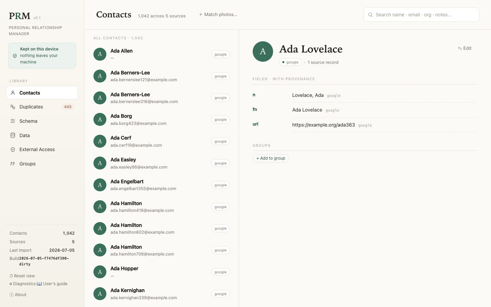

**Contacts** is home base: search or browse the full list, open any contact, and see every field with
its **provenance** — which source each value came from (`google`, `apple`, a `user` tag where you
overrode it, `gathered` where you accepted an AI suggestion). When a source is itself second-hand —
data imported from another application, like an EHF fellows directory archive — the contact header
also shows its **ultimate origin**, read from provenance embedded in the imported file itself: *"EHF
fellows — from EHF Fellows Directory (Knack), archived 2026-04-08"*. Search is prefix-matched across
name, email, organization, and notes, and also matches your private tags and custom values — locally
only (an AI's search never touches sealed data).

Row markers tell you at a glance: `N×` (merged from N records), **🤖** (AI-gathered data waiting for
your review), and `duplicate?` (a confident pending duplicate — see
[Duplicates](#duplicates--find--merge)).

### Edit a contact — notes, tags, photo, your fields

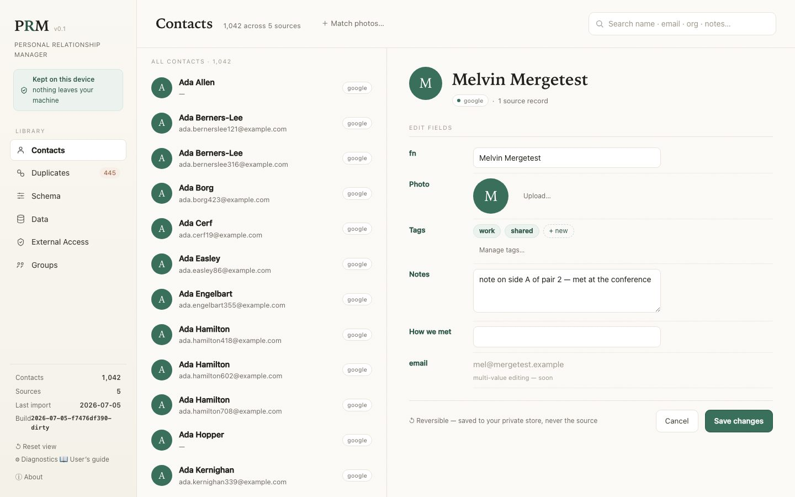

Open a contact and hit **✎ Edit**. Fix a single-valued field (a name, an org), write private
**notes**, apply **tags**, set a **photo**, and fill in any custom fields you've defined. Everything
you change is saved as a **layer on top of your imported records** — the import itself is never
modified — so a re-import can't clobber your edits, and one **Undo** reverses a whole save. *(Editing
multi-value fields — a contact's several emails/phones — is coming in a next increment.)*

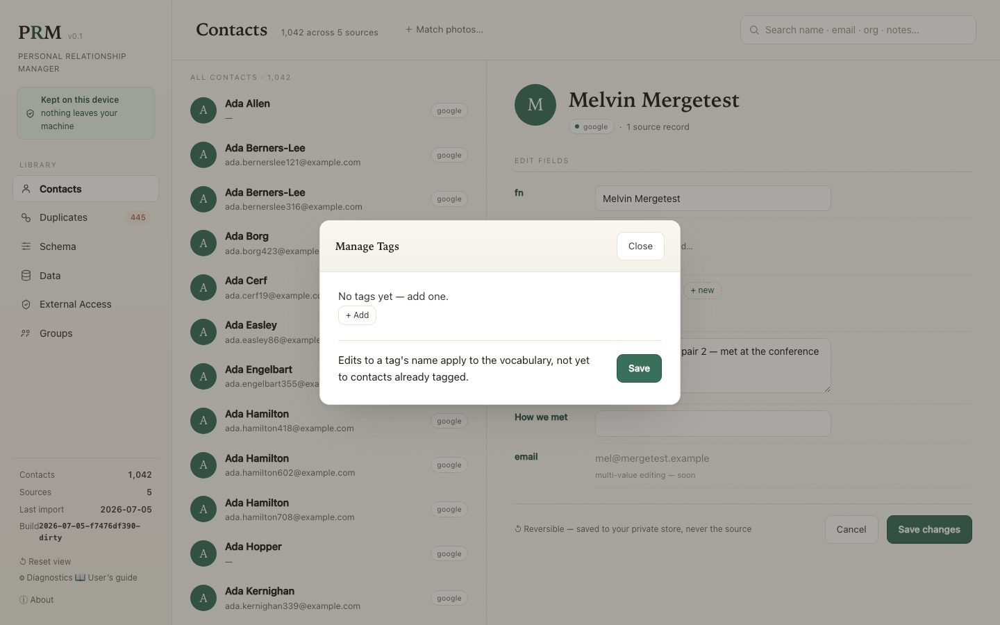

**Tags** come from a small vocabulary you manage — create one inline while tagging, or hit *Manage
tags…* to curate names and descriptions. Tagged contacts are searchable by tag from the main search
box, and the [Groups view](#groups--and-the-tags-browse) has a browse list of every tag with its count.

**Photos**: if your import carried one it shows automatically — including **Google Takeout**, which
ships photos as separate files that PRM matches back by name on import. Click the avatar (or use
**Upload…**/**Remove** in Edit mode) to set your own; uploads are shrunk to a thumbnail in your browser
before saving, stay on this device, and never reach a connected AI. Got a **folder of loose photos**?
**＋ Match photos…** at the top of Contacts walks you through them one at a time, suggesting the likely
contact from each filename — you click **Assign**, search for the right person, **Skip**, or mark
**Not a contact**. Only assigned photos are saved.

### Duplicates — find & merge

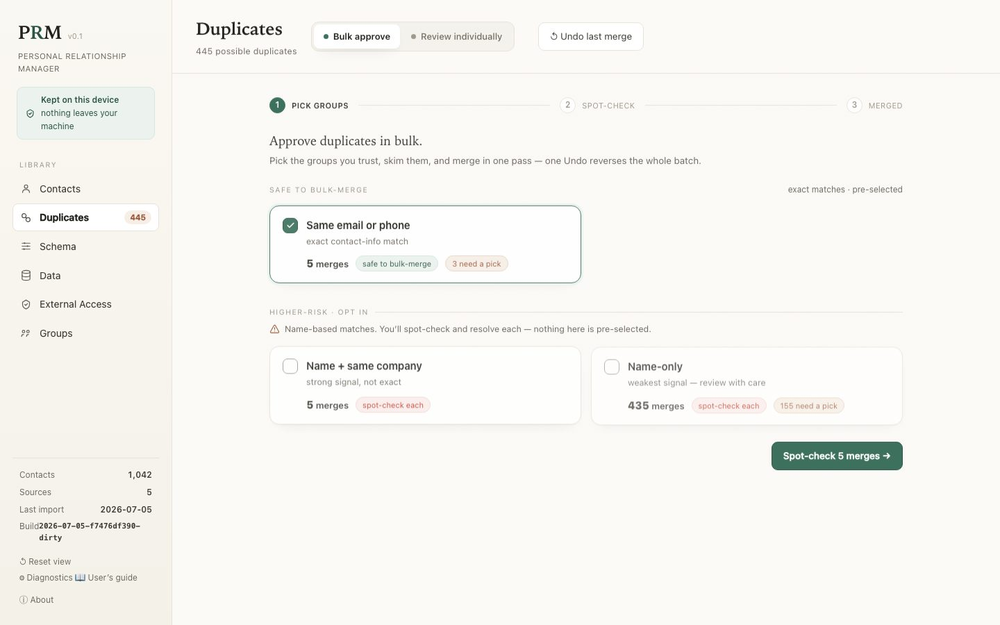

**Duplicates** finds contacts that look like the same person and helps you merge them. (For what a
merge actually does to the two stores, see **[How PRM's data works](explainers/how-prm-data-works.md)**,
§3–4.) The toggle next to the title picks the mode:

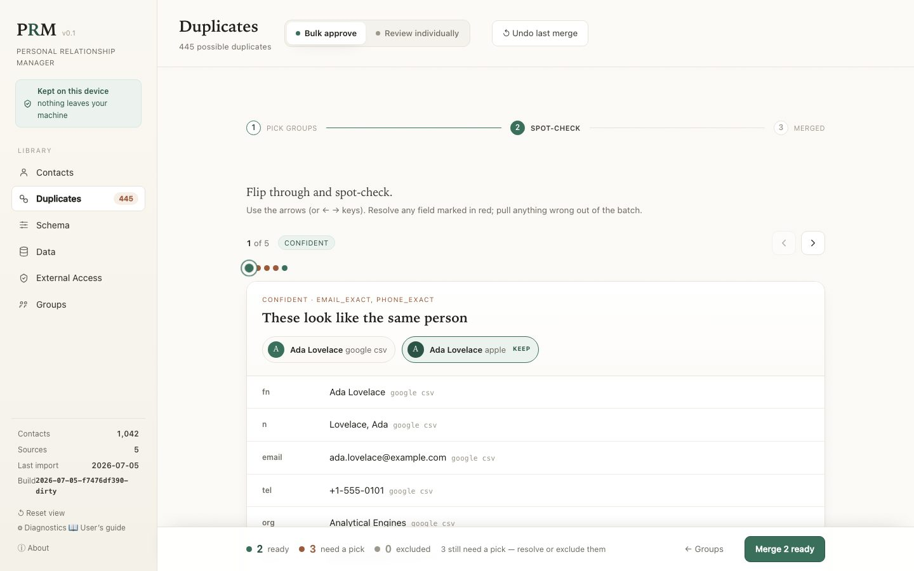

- **Bulk approve** — for clearing many at once. Pick the **groups** you trust (*same email or phone*,
  *AI-proposed* 🤖 — pre-selected; the weaker name-based groups are opt-in behind a confirm), then flip
  through them (← → keys) to spot-check. Resolve any red field conflict inline, or **exclude** anything
  that looks wrong — a card that still *needs a pick* when you merge is simply **left out of the
  batch** and stays in the queue. The batch applies atomically: a single **Undo** reverses all of it.

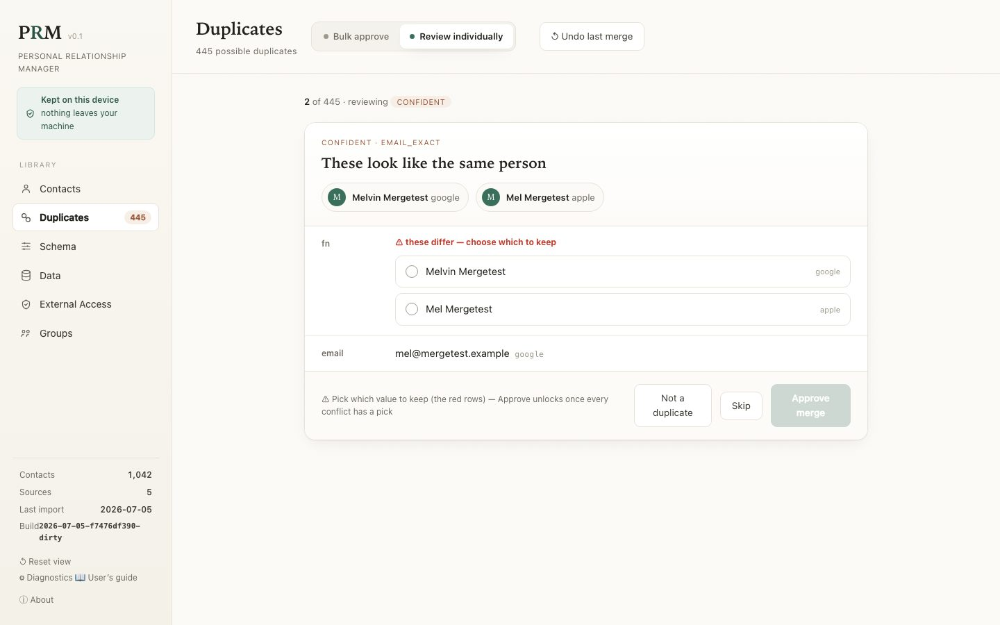

- **Review individually** — walk the candidates one at a time, most-confident first. Multi-valued
  fields (emails, phones) **combine**; a single-valued field that disagrees is flagged in red so **you
  pick which to keep** — *Approve merge* stays locked until every conflict has a pick. Your three
  choices are always **Approve merge**, **Not a duplicate** (dismissed for good), and **Skip** (decide
  later).

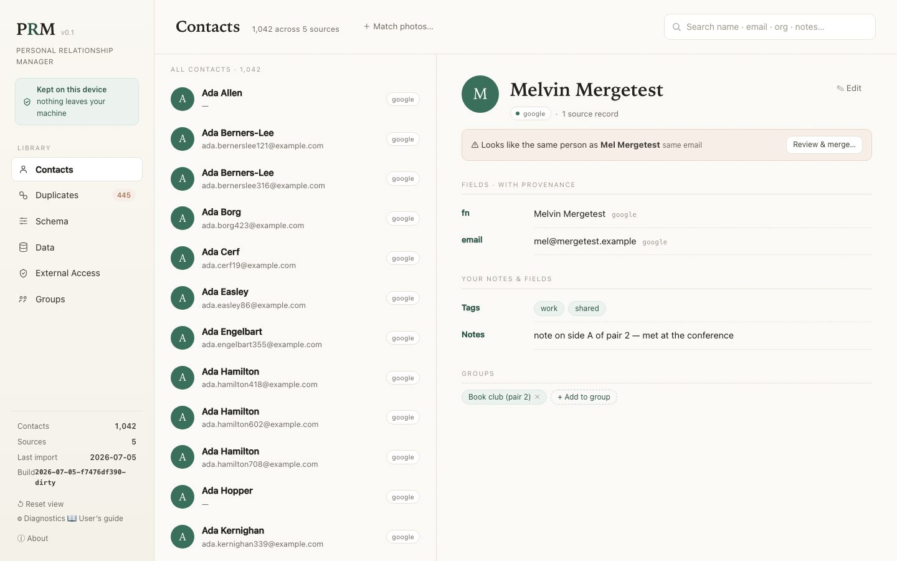

- **You don't have to start from this tab.** A contact with a *confident* (or AI-proposed) pending
  duplicate announces itself wherever you meet it: a `duplicate?` marker on its list row, a banner on
  its page — *"⚠ Looks like the same person as … — Review & merge…"* — and a call-out inside any group
  that holds both halves. Each takes you straight to the review card for exactly that pair. (Weak
  name-only matches don't get the marker — on real data they'd flag half your contacts.)
- **Your private data follows the merge.** Tags union, group memberships carry over, and if both
  contacts had a note (or any single-valued field you authored), **both values are kept** — shown side
  by side, never silently discarded — so you consolidate with one edit. A pending AI suggestion stays
  pending; one you'd already accepted returns to *pending your review* on the merged contact.
- Confident matches share an exact email, phone, or profile link; name-only matches are flagged and
  **never merged automatically**. **↺ Undo last merge** reverses the most recent merge or batch.

### Groups — and the tags browse

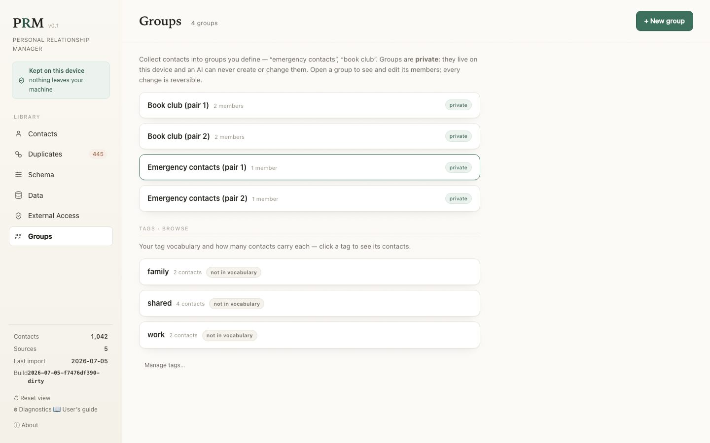

**Groups** collects contacts into sets you define — "emergency contacts", "book club". **+ New group**
takes a name and an optional note; open a group to see and edit its members — remove one, or **add
contacts by searching** right there. On any contact's page the **Groups chips** show where it belongs,
with **＋ Add to group** (which can also create a new group on the spot).

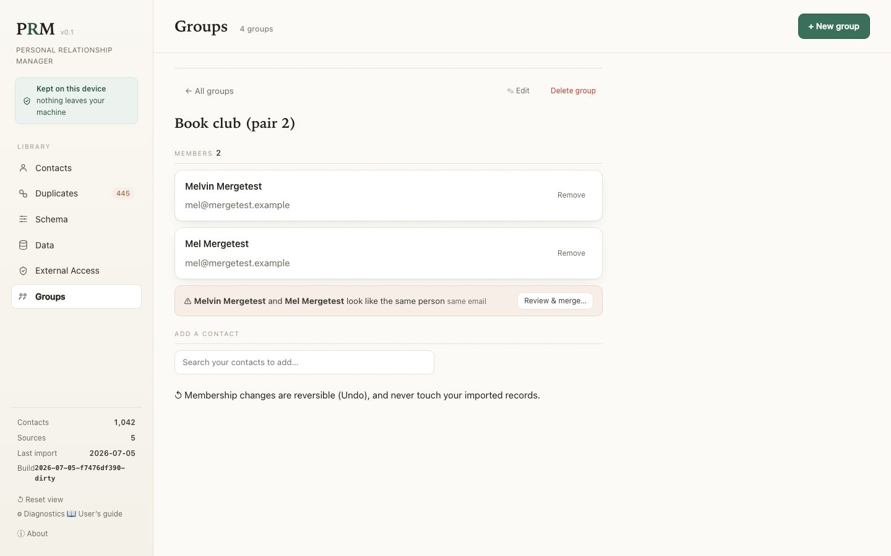

Groups are **private relationship data**: they live in your private store on this device, an AI can
never create or change one, every change is reversible (**Undo**), and memberships survive both
**merges** and **re-imports**. Deleting a group never touches the contacts in it. If a group ends up
holding **two contacts that look like the same person**, it calls that out with a **Review & merge…**
link — a group is never a merge surface itself, but it points you at the real one. The same view hosts
the **Tags browse**: every tag with its description and contact count — click one to see its contacts.
*(Coming next: filter the Contacts list by group, bulk-add many contacts at once, and export a single
group as a vCard.)*

### Schema — design your own fields

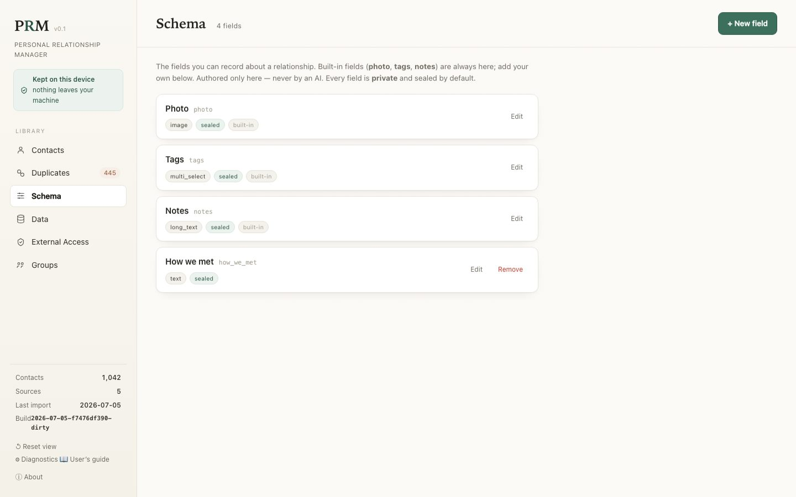

**Schema** is where you design your own relationship fields. The built-ins (`photo`/`tags`/`notes`)
are always there; **+ New field** adds your own — pick a **kind** (text, long text, number, date,
checkbox, single/multi-select, URL), give selects their options, mark it *required* if you like.

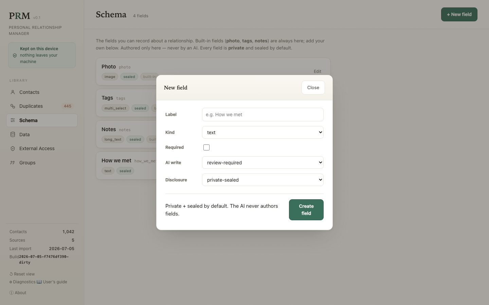

Every field is **private and sealed by default** — it never reaches a connected AI unless you later
mark it shareable — and appears on every contact's Edit form the moment you create it. You can edit or
remove your own fields (removal drops the field's values but is reversible by **Undo**); built-ins
can't be removed. The schema is authored **only here** — an AI can never invent or change your fields
(INV-3). *(Per-field AI-write policy is enforced for direct writes today; the full write-tier surface
matures in a later increment.)*

### Data — import & export, no terminal

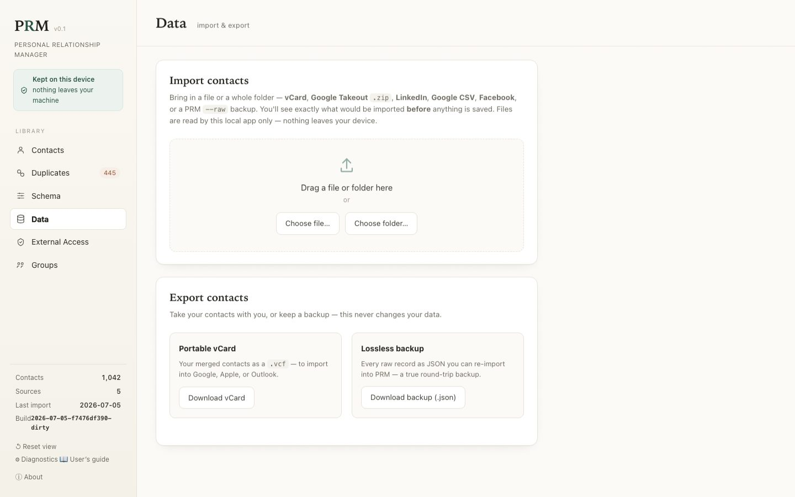

**Data** is the point-and-click counterpart to `prm import` / `prm export`. **To import**, drag a file
or folder onto the page — or **Choose file…** / **Choose folder…** — for any supported export (vCard,
Takeout `.zip`, LinkedIn, Google CSV, Facebook, a PRM `--raw` backup, or a **fellows_local_db**
directory archive `.db` — another PNA's shared database, imported with its embedded ultimate-source
provenance chain preserved). PRM reads the files
**locally**, shows the same preview the terminal does (contacts per file, detected source +
confidence, the stable-id breakdown), and saves **only after you confirm**. A low-confidence source
can be relabeled before importing; unrecognized files are listed as **skipped**, never silently
dropped. **To export**, download your merged contacts as a portable **vCard** or a lossless **backup**
you can re-import — see [exports, in depth](#export--portable-vcard-or-lossless-backup).
*(Re-importing an updated export with a change preview is still the terminal's `just reimport` — it's
coming to the workspace next.)*

### External Access — AI, consent, and the data-floor

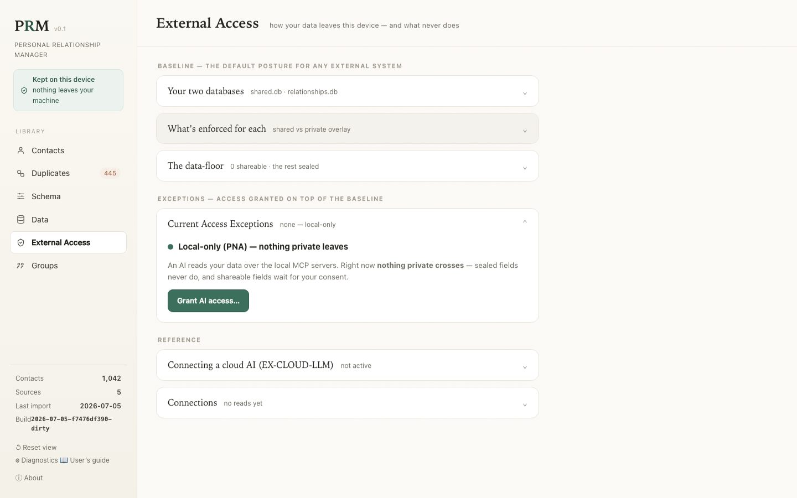

**External Access** is where you control what any AI can see, and see what it has seen. The page reads
top-down as **Baseline** (the default posture: your two databases, what's enforced for each, and the
**data-floor** — sealed fields never cross, only fields you mark *shareable-on-consent* can) above
**Current Access Exceptions** (everything you've granted on top).

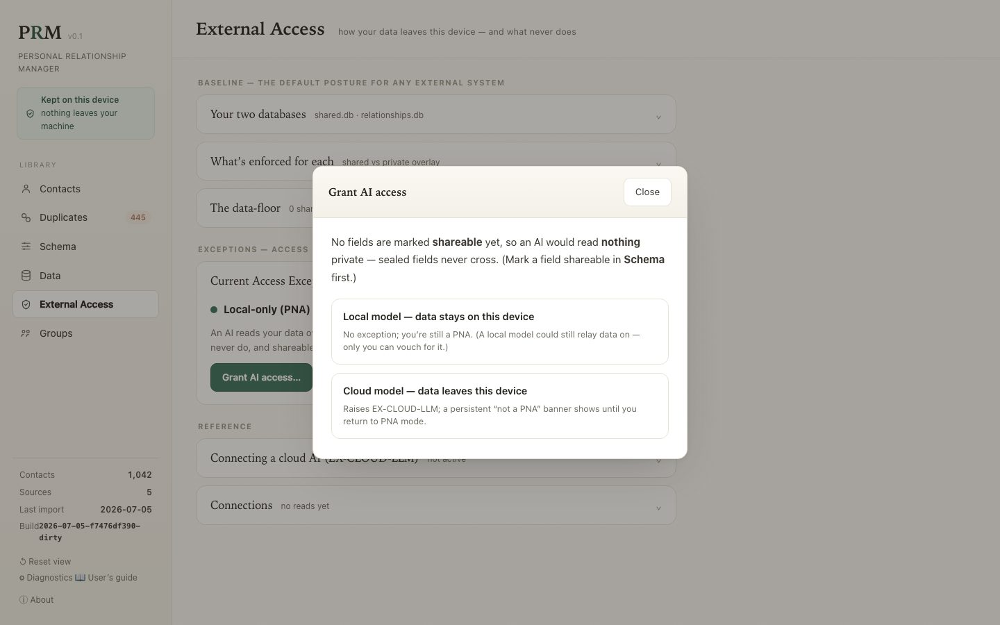

**Grant AI access…** opens the gate: pick **Local model — data stays on this device** (no exception)
or **Cloud model — data leaves this device**, which raises the **`EX-CLOUD-LLM`** exception and shows
a persistent *"not a PNA right now"* banner until you return. Before anything is shared you see the
**blast radius** — which fields, across how many contacts. Return to local-only mode anytime with one
click (it stops future sharing; it can't recall data already sent). For tighter control, turn on
**"Require my approval for each AI read"** — every read of a contact's shareable fields is then held
for your per-contact **Approve**/**Deny**. The exceptions list itemizes every approved contact — the
fields, when you approved it, when an AI last read it — each with its own **Revoke**. The
**Connections** card shows the last AI read with the serving **build** (catching an AI client running
a stale server), and **Test MCP servers** probes the registered servers on demand. Full screenshot
tour: **[AI reads & writes](explainers/ai-reads-and-writes-walkthrough.md)** (Part 1).

### Let an AI propose merges — and gather data (optional)

An AI assistant can do the dedup legwork: it scans for duplicates and **proposes** merges, which land
in the Duplicates tab tagged **🤖 AI proposal** for you to approve or reject — the AI can only
*propose*, never apply. Setup is two steps (details in [`../mcp_servers/README.md`](../mcp_servers/README.md)):

1. **Register the MCP servers** with your MCP client (e.g. Claude Desktop): `just mcp-install` does it
   in one step. The dedup flow uses `prm-shared-data` (read) + `prm-dedup` (propose). A third server,
   `prm-private-data`, lets an AI write values into fields you've marked AI-writable and file
   **gathered observations** (e.g. a phone for a name-only Facebook contact) — additive, attributed,
   and policy-gated (every field is sealed + review-required by default).
2. **Hand the assistant the dedup prompt** in
   [`../mcp_servers/prompts/dedup.md`](../mcp_servers/prompts/dedup.md) — paste or attach it; it is
   not auto-loaded.

Gathered observations appear on the contact under **"Gathered — pending your review"**: **Accept**
folds one into your view as a reversible private override (your imported records are never changed),
**Reject** dismisses it for good, or leave it to decide later; the 🤖 row marker flags contacts with
data waiting. Nothing is ever folded in until *you* accept it — there is no AI "promote" path. **A
local AI is recommended** for anything touching private data; the consent gate above makes the choice
explicit either way. (The three AI-write flavors are explained in
**[How PRM's data works](explainers/how-prm-data-works.md)**, §5.)

### What the workspace can't do yet

Being honest about the gaps (each is tracked on the [Roadmap](roadmap.md) unless noted):

- **Re-import an updated export** with a change preview — use `just reimport` (Part 2) for now.
- **Edit multi-value fields** (several emails/phones on one contact).
- **Group operations** — filter Contacts by a group, bulk-add many contacts, export one group.
- **Create a brand-new contact** or **delete one** — PRM mirrors your sources today; user-authored
  contacts and tombstones are a planned follow-on.
- **Seed the demo** — that's `just demo` in the terminal.
- **Back up your private store** (notes/tags/groups/photos) — the raw backup covers your mirrored
  contacts; a private-store backup is a separate, later feature. (The private store *is* plain files
  under your PRM home if you want to copy them yourself — see
  [Where your data lives](#where-your-data-lives).)

---

## Part 2 — The command line

Everything below reads and writes the same PRM home as the workspace. The `just` recipe is given
first; each is a thin wrapper over the `prm` command shown in the comment.

### Inspect an import (dry run)

```bash
just dry-run ~/Downloads/takeout-20260603.zip          # = prm import … --dry-run
```

```
Ingest DRY RUN — nothing written: 4 contacts from 1 file(s)
  - …/All Contacts.vcf: 4 · vcard (vcard, confidence low)
  by source: vcard=4
  stable-id: email=4  (1 name-less)
```

How to read it: the **per-file line** is `count · source (format, confidence)` — PRM detects the
*format* and infers a *source* label (`apple_icloud`, `google_takeout`, …); a bare `.vcf` with no
tell-tale markers shows as `vcard`/low. **stable-id** shows how each contact got its durable identity
(most sources carry no `UID`, so PRM falls back): `uid` → `email` → `url` → `hash`; *name-less* counts
contacts with no name at all (common in real exports). You can pass a **folder** (PRM recurses) or a
shell **glob**, and `--json` gives machine-readable output:

```bash
just dry-run ~/Downloads/                        # a folder — every recognized file previewed
just dry-run ~/Downloads/exports/*               # a glob — every export dumped loose in one folder
just dry-run takeout.zip --json                  # for scripts / the AI surface
```

### Import

```bash
just ingest ~/Downloads/takeout-20260603.zip           # = prm import …
just ingest contacts.vcf --source apple_icloud         # override the inferred source label
```

Interactive runs show the preview and prompt `Proceed with import? [y/N]`; `--non-interactive` (or
`--json`) never prompts. Importing is **idempotent** — the same file again updates rather than
duplicates — and sources accumulate into one home (a Takeout `.zip`, then an Apple `.vcf`, …).

### Re-import an updated export

```bash
just reimport ~/Downloads/takeout-20260820.zip --source google_takeout --dry-run   # preview only
just reimport ~/Downloads/takeout-20260820.zip --source google_takeout             # preview → confirm
```

Reports, per source, what's **new / updated / unchanged / stale** (in your store but no longer in the
export) before committing. **Non-destructive**: stale records are kept (flagged), and your merge
decisions are preserved — re-attached by stable identity (INV-6). A snapshot precedes it; the audit
log records it. (Why a re-import can't clobber your edits:
**[How PRM's data works](explainers/how-prm-data-works.md)**, §2.)

### Status and search

```bash
just status           # the home, record + identity counts, per-source split, last import
just search "ada"     # prefix-matched across name/email/org/notes; --limit N; --json
```

### Export — portable vCard, or lossless backup

```bash
just export --out contacts.vcf        # merged contacts as vCard 3.0 (Google/Apple/Outlook import it)
just export --raw --out backup.json   # every raw record + provenance, re-importable losslessly
```

The **vCard** is the *merged* view — one card per person, multi-valued fields unioned, your dedup
choices applied — a **portability** export (re-importing it creates fresh records). The **`--raw`
backup** is the true round-trip: re-importing rebuilds the same records with the same identities
(`just ingest backup.json`). It covers the **mirrored contacts store**; private-store data (notes,
tags, groups) lives separately — see the gap list below.

### Serve, stop, doctor, config

```bash
just serve            # the workspace server (prints the session link);  just serve 9000 for a port
just open             # open the running server's link in your browser
just stop             # stop it cleanly from another terminal (just stop 9000 for that port)
prm doctor            # sanitized diagnostics: store stats, lock state, build label — no contact data
prm doctor --unlock   # clear a stale home lock (refuses while a PRM process is live)
prm config --show     # where your data lives and how the location was resolved
just mcp-install      # register the MCP servers with your AI client (backs up its config first)
```

If the port is taken, `just serve` says so and exits (it never kills anything); `just port`
force-frees a port a *crashed* run left stuck.

### What the CLI can't do

- **Relationship data is workspace-only, by design**: notes, tags, groups, photos, custom fields, and
  merging all happen in the workspace — the schema and your curation deliberately have one authoring
  surface (INV-3), so there are no CLI commands for them.
- **No dedup from the terminal** — reviewing merges is inherently visual; the CLI's job ends at
  getting records in and out.
- If you'd want any of these anyway, open an issue — the honest gap list is the point of this section.

---

## Part 3 — Concepts & reference

### Where your data lives

Everything for one instance lives under a single **PRM home** directory, resolved in this order:
`--data-dir` on the command line → the `PRM_HOME` environment variable → the location `just install`
recorded → `./prm-data/` in the repo (the default, so demo/dev runs never write outside it).

```
prm-data/
  shared.db          # mirrored contacts (read-only at runtime; only an import writes it)
  relationships.db   # your private data: notes/tags/groups/fields + merge decisions (local-only)
  media/             # content-addressed contact images (local-only)
  proposals/         # staged AI change-sets awaiting your review
  snapshots/         # pre-change backups (what Undo restores)
  audit.log.jsonl    # append-only log of every applied change
```

The **two databases** are the architecture in one sentence: `shared.db` is the disposable,
re-mirrorable copy of what your sources say; `relationships.db` is the sovereign layer you author,
which no import, re-import, or AI can overwrite. (The full picture, illustrated:
**[How PRM's data works](explainers/how-prm-data-works.md)**.)

### Privacy

- **Local-only by design.** Your contacts and private data never leave your device (**INV-1**). The
  one sanctioned exception is connecting a **cloud** AI — and only through the explicit, reversible
  consent gate in [External Access](#external-access--ai-consent-and-the-data-floor).
- **Real exports are never committed.** Drop them in `ignore-data/` (gitignored) or anywhere outside
  the repo. All committed test data is synthetic.
- The mirrored contacts store is **read-only at runtime** — only a deliberate, user-run import writes it.
- **Other programs on your computer.** The workspace API is session-protected, so another local
  program can't read your contacts through it. But your data lives in ordinary files under your PRM
  home, which **any process running as your user account can read directly** — an operating-system
  boundary PRM can't close from inside the app. This matters more as people run **OS-level automation
  or AI agents** (which often act with your full access and may be cloud-backed): treat any such agent
  as having access to your contacts. To harden: run only agents you trust, keep your disk encrypted,
  or run PRM under a separate OS user account. (Background:
  [`design-notes/local-daemon-trust-surface.md`](design-notes/local-daemon-trust-surface.md).)

### Troubleshooting

- **`ModuleNotFoundError: vobjectx`** — run `just setup` (it installs it), or `pip install vobjectx`.
  The older `vobject` is used automatically if present.
- **A file is "SKIPPED" as unrecognized** — PRM imports vCard (`.vcf`), Google Takeout (`.zip`),
  LinkedIn (`.zip`/`Connections.csv`), Google CSV (`.csv`), Facebook friends (`.zip`/`.json`), and its
  own raw backup (`.json`). Other files in an export folder are ignored. A Facebook friend is just a
  *name and connection date* — no email or phone — so those contacts are intentionally thin.
- **`prm: command not found`** — the `just` recipes don't need `prm` on your PATH (they run `./.venv`
  directly). To use `prm` itself: `just shell`, or `source .venv/bin/activate`, or `python3 -m cli …`.
- **The workspace port is stuck** — `just stop` shuts a running server down cleanly; `just port`
  force-frees a port a crashed run left held.
- **Filing a bug** — `prm doctor` (or the workspace's **⚙ Diagnostics** / `?diag`) prints a
  **sanitized** dump — store stats, lock state, the build label `<date>-<sha>`, **no contact data** —
  to paste into the report.

### What's next

The near-term increments, in rough order (the [Roadmap](roadmap.md) owns the full plan): **group
operations** (filter/bulk-add/export a group), the **read-only MCP group tools** (an AI can answer
"who's in my book club" — never change it), **workspace re-import**, and **multi-value field
editing**. After that, v0.3 begins **delegated gathering** — an AI doing daily public-data checks over
a group you choose, filing everything as reviewable observations.

### References

- **Illustrated explainers**: **[How PRM's data works](explainers/how-prm-data-works.md)** ·
  **[AI reads & writes — a visual walkthrough](explainers/ai-reads-and-writes-walkthrough.md)**
- **[Feature specification](prm-feature-spec.md)** — features (`F#`), invariants (`INV#`), the
  safe-AI-write model · **[Roadmap](roadmap.md)** — versioned plan ·
  **[Architecture / conformance](Architecture.md)** — the PNT attestation
- **[v0.1](../plans/v0.1-implementation-plan.md)** / **[v0.2](../plans/v0.2-implementation-plan.md)**
  implementation plans · **[Ingestor README](../cli/README.md)** ·
  **[MCP servers README](../mcp_servers/README.md)**
- **[Source format validation status](reference/source_validation_status.md)** — which export formats
  are verified against real-world data · **[Test fixtures](../tests/fixtures/README.md)** — the
  synthetic corpora
- The screenshots in this guide are captured **repeatably** against the synthetic demo by
  [`scripts/capture_screenshots.py`](../scripts/capture_screenshots.py) — after a UI change, one
  command refreshes them all.
- **Open question:** [What "distribution" means for a PNA](https://github.com/richbodo/prm/issues/8)
  — the build-from-source-and-verify trust model behind this guide's setup steps.
